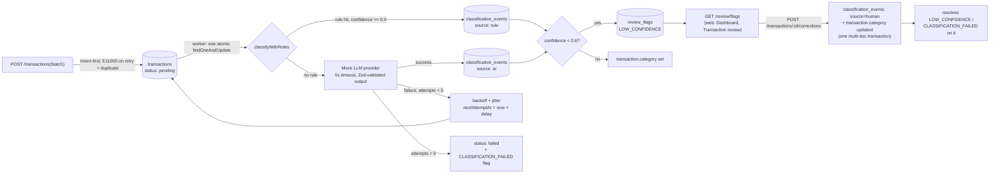

# Sycamore Transaction Intelligence Platform

A multi-tenant transaction import, AI-assisted categorisation, and human review platform
for Nigerian businesses, built for the Sycamore Capital Group technical assessment
(the brief is in `docs/ASSESSMENT.md`).

I am not expected to have built a production-complete system in this time box. What follows
explains what I built, why, and what I'd do differently with more time.

## 1. Running it

### Prerequisites

- **Docker + Docker Compose** (the recommended path — this is all you need), **or**
- **Node.js 22+** and a MongoDB 7 replica set of your own, if you'd rather run it without
  Docker (see [Running without Docker](#running-without-docker) below).

### Quick start (Docker)

From the repository root:

```bash
# 1. Copy the example env file. docker-compose.yml configures the containers
#    itself, but this is also what npm run seed reads when run from your host.
cp api/.env.example api/.env

# 2. Build and start MongoDB (as a replica set), the API, the classification
#    worker, and the web app.
docker compose up -d --build

# 3. Load two organisations and ~400 transactions through the real import API.
cd api && npm run seed
```

Give the worker a few seconds to classify the newly seeded transactions, then open
**http://localhost:5173** and log in as:

| Organisation | Email | Password |
|---|---|---|
| Lagos Fresh Foods Ltd (food retail) | `adaeze.okafor@lagosfreshfoods.ng` | `Passw0rd!2024` |
| Nimbus Cloud Systems Ltd (SaaS) | `chidi.eze@nimbuscloud.ng` | `Passw0rd!2024` |

(The password is `SEED_PASSWORD` in `api/.env.example`; both seed organisations use it.)

**Checking it's actually up**, if anything looks wrong:

```bash
docker compose ps                              # all five services should be "running"
curl http://localhost:4000/health              # {"status":"ok","db":"connected"}
curl -o /dev/null -w "%{http_code}\n" http://localhost:5173   # 200
```

**Stopping it:**

```bash
docker compose down            # stops and removes the containers, keeps the data
docker compose down -v         # also deletes the MongoDB data volume (next start reseeds clean)
```

**If you change any source file** after the stack is already running, the containers won't
pick it up automatically — `docker compose up -d --build` only copies code in at image-build
time, it isn't a live mount. Re-run `docker compose up -d --build` (optionally with just the
one service that changed, e.g. `docker compose up -d --build web`) to rebuild and restart.

### Running without Docker

```bash
cp api/.env.example api/.env       # point MONGO_URI at your own replica set
cp web/.env.example web/.env

cd api && npm install && npm run dev      # terminal 1: the API, on :4000
cd api && npm run worker                  # terminal 2: the classification worker
cd web && npm install && npm run dev      # terminal 3: the web app, on :5173
```

Then, from `api/`, run `npm run seed` once to load the sample data (needs the API's `.env`
in place so it can reach your MongoDB). Your own MongoDB must be running as a replica set —
even a single-node one — because the correction endpoint uses a multi-document transaction,
which Mongo only supports on a replica set.

### Command reference

| Command | Where | What it does |
|---|---|---|
| `docker compose up -d --build` | repo root | Build and start everything |
| `docker compose down` | repo root | Stop everything |
| `docker compose logs -f api\|worker\|web\|mongo` | repo root | Tail one service's logs |
| `npm run dev` | `api/` | Run the API with hot reload |
| `npm run worker` | `api/` | Run the classification worker |
| `npm test` | `api/` | Run the API test suite (needs Mongo reachable) |
| `npm run typecheck` | `api/` or `web/` | Type-check without emitting |
| `npm run seed` | `api/` | Load the sample organisations/accounts/transactions (idempotent — safe to re-run) |
| `npm run openapi` | `api/` | Regenerate `docs/openapi.json` |
| `npm run dev` | `web/` | Run the web app with hot reload |
| `npm run build` | `web/` | Type-check and build the web app for production |

## 2. Architecture

```
api/src/
  config/        env parsing; the process exits on invalid config
  http/          Fastify app, auth hook, request context, global error handler
  db/            connection, tenant-guard plugin, Mongoose models
  money/         kobo parsing/formatting — the only module that touches amount arithmetic
  modules/
    auth/ accounts/ transactions/ classification/ review/ dashboard/
      *.routes.ts    parses the request, calls the service, sends the response
      *.service.ts   the rules: idempotency, tenant checks, orchestration
      *.repository.ts  the only code that touches Mongoose
  worker/        the classification claim loop
  seed/          deterministic seed data, loaded through the real import service
web/src/
  api/           typed fetch client
  auth/          token + user in localStorage
  components/    Layout, MoneyValue, StatusBadge, SpendingBars
  pages/         Dashboard, Transactions, Transaction detail/review
```

One transaction's life, import to corrected category:



Two detectors (`POSSIBLE_DUPLICATE`, `UNUSUALLY_LARGE`) run after every classification
attempt, independent of whether it succeeded — they're about the raw transaction, not its
category.

## 3. Decisions and why

- **Fastify** over Express/NestJS: first-class TypeScript, and route *encapsulation* is
  exactly what scopes the auth hook to protected routes without a decorator or middleware
  array — `app.register(async (protectedApp) => {...}, { prefix: '/api/v1' })` adds the hook
  only inside that closure (`api/src/http/app.ts`).
- **MongoDB** for financial data: the honest case against it is that it enforces nothing
  about tenant isolation, referential integrity, or numeric precision on its own — three
  specific gaps, each covered by something explicit rather than by convention:
  - Tenant isolation: a Mongoose plugin (`db/tenantPlugin.ts`) throws on any query/update/
    aggregate against a tenant collection with no `organisationId` in the filter.
  - Numeric precision: amounts are stored as 64-bit `Long`, never `Double`; see §4.
  - Referential integrity (nothing stops an `accountId` pointing at a deleted account): the
    repository layer is the only code that writes, and every write path that creates a
    transaction first confirms the account exists in the caller's organisation.
  What Mongo *does* give for free that mattered: a document model that fits "a transaction
  carries its own classification state" far more naturally than a normalized row would, and
  multi-document transactions (replica set required — that's why `docker-compose.yml`'s
  `mongo-init` runs `rs.initiate()`) for the one place two documents must change atomically
  (a correction).
- **No external queue.** The transaction document *is* the queue entry: `classification.
  {status, attempts, nextAttemptAt, lockedUntil}` plus one atomic `findOneAndUpdate` claim
  (`classification.repository.ts`) gets retry, backoff, and crash recovery (an expired lock
  gets reclaimed) without running or operating Redis/SQS/RabbitMQ. The cost: no priority
  ordering beyond "oldest due first," and polling (`WORKER_POLL_INTERVAL_MS`) instead of a
  push. See design scenario 3 for where this stops being the right call.
- **Rules before AI, always.** A rule hit is free, instant, and auditable (`rules.ts`); the
  AI step only ever sees narrations rules couldn't decide. This is also why ingestion never
  touches the classification provider at all — the two are fully decoupled modules.

## 4. Financial correctness

Worked example: **₦12,999.75**.

1. The API rejects anything that isn't a string matching `^\d+(\.\d{1,2})?$` — a JSON number
   (`12999.75`) is rejected with a message saying why, not silently coerced.
2. `parseAmountToKobo` (`api/src/money/money.ts`) splits on the decimal point and combines
   with `bigint` multiplication: `12999n * 100n + 75n = 1299975n`. No `parseFloat`, no
   `Number()`, no `* 100`.
3. Stored as `Schema.Types.BigInt` → BSON `Long`. The driver is configured with
   `useBigInt64: true` (`db/connection.ts`), so it round-trips back out as a native
   `bigint`, not the `mongodb.Long` wrapper object — proved with a test that stores and
   rereads a value above `Number.MAX_SAFE_INTEGER` (`test/ingestion.test.ts`).
4. Summed in aggregation (dashboard totals, spending by category) as `Long` the whole way —
   MongoDB's `$sum` over an integer BSON type stays integer server-side, and `useBigInt64`
   is what brings that back as `bigint` client-side instead of silently widening to a
   double.
5. Formatted back to `"12999.75"` by `formatKoboAsAmount`, again by string construction, not
   division.

One real bug came out of this area, worth remembering: `Model.aggregate()` does **not** cast
`$match` against the schema the way `Model.find()` does. Passing the plain string `organisationId`
into an aggregation pipeline's `$match` compared it against a stored `ObjectId` and matched
nothing — every dashboard total came back `0`, silently, for every organisation. Fixed with
an explicit `new mongoose.Types.ObjectId(organisationId)` in `dashboard.repository.ts`.

The web app only ever formats these decimal strings (`web/src/money/money.ts`); the one
place it compares amounts by magnitude (sizing a spending bar) does the comparison in
`bigint`, converting to a JS number only for the final 0-100 percentage — already a small
exact integer with nothing to lose.

## 5. Tenant isolation

Three layers, as specified:

1. **Request context.** `organisationId` is set exactly once, in `authHook.ts`, from the
   verified JWT's claim — never read from a body, query string, or path parameter.
   `requireOrganisationId()` is the only way code gets it.
2. **Repositories.** Every repository function takes `organisationId` as a required first
   argument and puts it in the filter.
3. **The Mongoose plugin backstop.** `tenantScopePlugin` throws on any `find`/`update`/
   `aggregate`/`save`/`insertMany` against a tenant collection (`accounts`, `transactions`,
   `classification_events`, `review_flags`) with no `organisationId` in the filter — a
   second line of defence if a repository mistake ever shipped.

**One documented exception each way:**

- The worker's claim query (`classification.repository.ts`'s `claimNextTransaction`) is the
  one explicit, commented bypass of the plugin — by design it looks across every
  organisation at once, since it doesn't yet know which organisation's transaction is next.
- `users` carries `organisationId` like every other tenant collection, but is **not**
  wrapped with the plugin: logging in means finding a user by email *alone*, before
  `organisationId` is known, which is exactly the query the plugin exists to forbid. Adding
  a second bypass for it would have contradicted the rule that there's only one. Every other
  read of `users` still takes `organisationId` as an explicit filter (defence in depth, just
  without the Mongoose-level backstop).

A resource outside the caller's organisation always returns `404`, never `403` — tested for
accounts, transactions, review flags, and corrections.

## 6. AI reliability

`ClassificationProvider` (`modules/classification/provider.ts`) is a small interface — one
`classify(input, signal)` method — so the AI backend can be swapped (mock today, a real
vendor later) without touching the worker, the retry logic, or anything upstream. Rules are
deliberately *not* an implementation of it; they're a synchronous pre-filter that runs
first and never needs swapping.

Failure handling, all in `classification.service.ts`:

- **5-second timeout** via `AbortController`, regardless of which `MOCK_LLM_MODE` is active.
- **Zod-validated output** (`classification.schema.ts`): an unknown category or an
  out-of-range confidence is treated as a failure, not cast.
- **Exponential backoff with jitter** between attempts; a rate-limited response honours its
  own `retryAfterMs` instead of the generic backoff.
- **Max 5 attempts**, then `status: failed` and a `CLASSIFICATION_FAILED` flag.
- **Circuit breaker**: after 5 consecutive AI failures, skip calling the provider for a 30s
  cool-off and go straight to rescheduling — rules keep classifying the whole time. In-memory
  and process-global; explicitly the first thing cut if time ran short (it didn't).
- **Ingestion never depends on any of this.** Import handlers (`transactions.service.ts`)
  never import the classification module at all — a provider outage changes nothing about
  whether `POST /transactions` succeeds, tested directly (`classification.test.ts`,
  "ingestion does not depend on AI").

`MOCK_LLM_MODE` (`ok | slow | down | rate_limited | invalid`) plus `MOCK_LLM_FAILURE_RATE`
let every one of those failure paths be exercised on demand; `setMockLlmMode` /
`setMockLlmFailureRate` (`mockLlmProvider.ts`) make that possible mid-test-run without a
restart.

## 7. Testing

85 tests, Vitest, Fastify `inject`, against a real MongoDB replica set (no mocked database).
`api/test/setup.ts` connects once per run; most fixtures use a fresh organisation/user per
test so tests never depend on execution order — the one exception is
`classification.test.ts`, which documents at the top of the file why it drains the worker's
globally-shared claim queue before each test.

```
cd api
docker compose up -d mongo mongo-init    # from the repo root, or use the full stack
npm test                                  # everything
npm test -- test/classification.test.ts   # one file
npm run typecheck
```

Coverage maps closely onto what the brief calls out explicitly: money, idempotency and
concurrency, tenancy, every classification failure mode, audit history, one positive and one
negative case per detector. The web app was verified by driving a real browser against the
real stack rather than with a Vitest/RTL suite (see §10).

## 8. Assumptions and trade-offs

- **NGN only.** `currency` must be exactly `"NGN"`; anything else is a validation error.
  Multi-currency would need an FX layer and a currency-aware `largePaymentMultiple`, out of
  scope here.
- **Roles are stored but not enforced.** `admin`/`member` exist on `User`, but no endpoint
  checks either — anyone authenticated in an organisation can import, correct, and resolve.
  A reasonable cut for a prototype at this scope; real role-gating would be next.
- **Login rate limiting and the classification circuit breaker are in-memory,
  per-process.** Correct for one API/worker instance; a horizontally scaled deployment would
  need both moved to a shared store (Redis), as noted at each definition site.
- **Keyset pagination only — no total counts.** `GET /transactions` and `GET /review/flags`
  never expose "page 3 of 40" because that would need a `count()` that gets slower as the
  collection grows; "Load more" / cursor-forward is the trade for staying fast at scale.
- **The web UI doesn't expose every filter the API supports.** `minAmount`/`maxAmount` work
  against the API (tested) but aren't wired into the Transactions page's filter bar, to keep
  that bar usable rather than exhaustive.
- **Seed volume** is ~400 transactions total (193 + 202) across two organisations over three
  months — comfortably "a few hundred" in aggregate, on the lower end of that phrase read
  per-organisation. Generating more would be a matter of widening the weekly loops in
  `api/src/seed/generateTransactions.ts`, not a design change.
- **No admin/invite flow.** Organisations, users, and accounts only exist via the seed
  script or direct database access; there's no `POST /organisations` or `POST /users`. Out
  of scope for what the brief asks the API to do.

## 9. Design scenarios

**AI reliability — a six-hour outage with hundreds of thousands of transactions arriving.**
Nothing about ingestion changes: imports keep succeeding and queue up as `pending`, because
the import path never calls the classification provider. The worker keeps trying, but after
five consecutive AI failures the circuit breaker stops calling the dead provider for 30s
stretches at a time, so retries don't themselves become load on (or billed cost against) a
service that's down — rules keep absorbing whatever volume they can the entire time. Once
the provider recovers, the backlog drains in oldest-due-first order with no manual
intervention needed; at "hundreds of thousands" scale a single worker process would take a
while to catch up, so the lever to pull is running more worker replicas (safe already, since
the claim is one atomic `findOneAndUpdate`) and watching `pendingClassificationCount` on the
dashboard as the signal for whether to add more.

**AI cost at millions of transactions a day, without hurting accuracy.** Rules absorbing as
much deterministic volume as possible is already the design and is the single biggest cost
lever available — every rule hit is a model call avoided. Beyond that: cache classification
results by a normalised `(narration, merchant)` key across the whole platform, not per
organisation, since unrelated businesses share the same bank-fee boilerplate and the same
handful of cloud vendors; batch several transactions into one LLM call instead of one call
per row; route to a cheap/small model first and escalate to a stronger one only when its own
confidence is low; and feed back corrections (`classification_events` with `source: human`)
into new rules on a regular cadence, so the set of narrations that actually need the model
keeps shrinking over time instead of staying fixed.

**Scaling from 100,000 to 10 million transactions a day.** The current design (single Mongo
replica set, one worker polling, in-memory rate limiter and breaker) is right-sized for the
lower end, not the upper one. At 10M/day I'd: shard `transactions` by `organisationId` (the
natural tenant boundary, and already the leading field of every index); replace poll-and-
claim with a real queue (SQS/Kafka) so there's back-pressure and consumer groups instead of
one claim loop competing with itself; move the rate limiter and circuit breaker to Redis so
they're correct across replicas instead of per-process; add a denormalised read model for
the dashboard so heavy aggregation stops competing with the hot write path; and introduce
time-based partitioning/archiving so the working set for recent-data queries doesn't keep
growing forever.

**Product trust — a customer says AI categorisation is making their finance team distrust
the dashboard.** First step is data, not reassurance: pull `GET /transactions/:id` for the
specific transactions they're pointing at and look at `classificationHistory` — which
provider or rule produced the category, and at what confidence. If those transactions are
sitting on an unresolved `LOW_CONFIDENCE` flag, the system already knew it wasn't sure; the
complaint may be as much about the review workflow not being used as about accuracy itself.
If a specific vendor or narration pattern is consistently wrong, that's a same-day fix — add
a rule for it, which takes effect with zero latency and no model change, exactly because
rules exist for this. And check whether their own corrections are flowing anywhere: the
audit trail (`classification_events`) is the raw material for exactly this feedback loop,
and if it's just sitting there un-mined, that's the real process gap to close.

## 10. Unfinished work and possible next steps

- Hand-maintained OpenAPI spec (`docs/openapi.json`, `GET /docs`) rather than generated from
  the Zod schemas — `fastify-type-provider-zod` would close that gap but means every route's
  validation moving from an inline `.parse()` call to a schema on the route options.
- No automated UI test suite; the web app was verified against the real stack in a browser
  rather than with Playwright/RTL.
- `minAmount`/`maxAmount` filters exist in the API but not the Transactions page's UI.
- No role gating, no admin/invite endpoints, no CI pipeline config.
- Login rate limiting and the classification circuit breaker are per-process; both are
  clearly marked at their definition site as the first things to move to a shared store in a
  multi-instance deployment.
- `GET /health` reports database connectivity but not the pending-classification backlog
  size in its body yet — `pendingClassificationCount` is already computed for the dashboard
  and would be a small addition to wire the same query into the health check.
